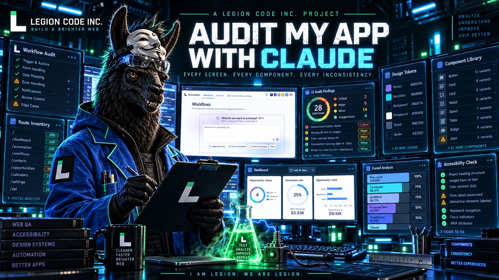
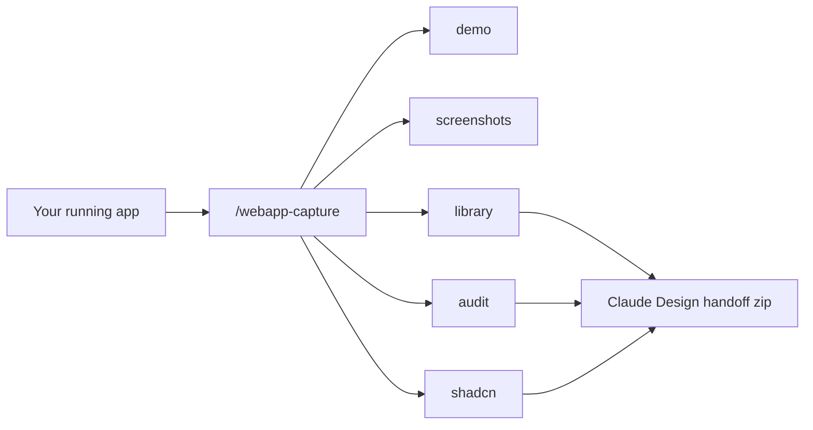
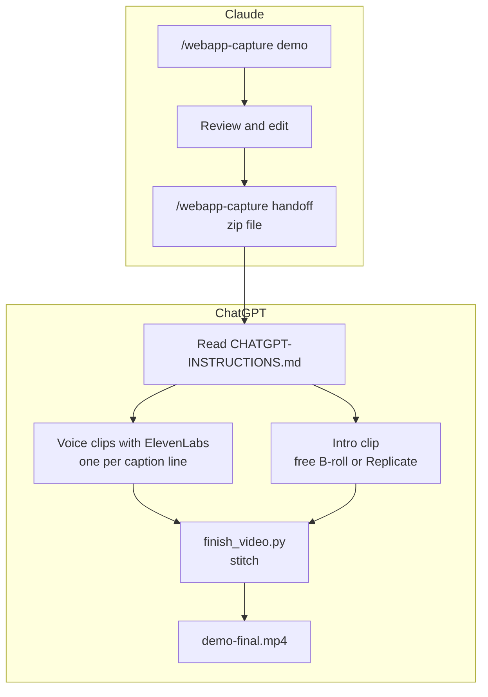

<!-- ───────────────────────────────  HERO  ─────────────────────────────── -->

<h1 align="center">Make Demo Videos & Audit My UX/UI with Claude</h1>

<p align="center">
  <strong>Your app already contains a design system. Make it visible.</strong>
</p>

<p align="center">
  
  
  <a href="LICENSE.md"></a>
</p>

<p align="center">
  <a href="https://github.com/legioncodeinc">
    <picture>
      <source media="(prefers-color-scheme: dark)" srcset="assets/brand/legion-logo-dark.svg">
      
    </picture>
  </a>
</p>

<p align="center"><em>Designed and built by <a href="https://github.com/legioncodeinc">Legion Code Inc.</a></em></p>

<p align="center">
  
</p>

---

Make Demo Videos & Audit My UX/UI with Claude turns a running web application into a documented component library, measured design tokens, organized screenshots, demo videos, and actionable UI inconsistency findings.

Inspect what users actually see. Find mismatched colors, inconsistent spacing, and components that behave like they were built by five different teams. Package the results for Claude Design or map them to shadcn/ui.

Designed and built by Legion Code Inc.

**I am Legion. We are Legion.**

## Start here

**Never used AI coding tools before?** You only need the Claude desktop app. Follow these guides in order. Each step says what to click or type, what you will see, and what to do if it goes wrong.

1. [Install everything](plugins/webapp-capture/docs/01-install-everything.md): the Claude desktop app, this plugin, and the free tools (once)
2. [Your first demo video](plugins/webapp-capture/docs/02-your-first-demo-video.md): from zero to a captioned video of your app
3. [Screenshots, library and audit](plugins/webapp-capture/docs/03-screenshots-library-audit.md): the other four jobs
4. [Finish your video in ChatGPT](plugins/webapp-capture/docs/04-finish-in-chatgpt.md): voice, intro clip, final stitch
5. [Make money with it](plugins/webapp-capture/docs/05-make-money.md): prices, fees, and selling on Upwork and Fiverr
6. [Fix problems](plugins/webapp-capture/docs/06-fix-problems.md): what you see, and what to do

All guides in one place: the [guide index](plugins/webapp-capture/docs/README.md) and the [branded PDF](plugins/webapp-capture/docs/webapp-capture-usage-guide.pdf).

**Already use Claude Code?** Jump to [Quick start](#quick-start). It works the same in the desktop app's Code tab or in a terminal.

## Contents

- [Start here](#start-here)
- [Quick start](#quick-start)
- [What you get](#what-you-get)
- [Common prompts (copy and paste)](#common-prompts-copy-and-paste)
- [Finish the video in ChatGPT](#finish-the-video-in-chatgpt)
- [Replicate (only for AI-made intro clips)](#replicate-only-for-ai-made-intro-clips)
- [What runs in parallel](#what-runs-in-parallel)
- [Free B-roll sites](#free-b-roll-sites)
- [Make money with it](#make-money-with-it)
- [Proven on a real app](#proven-on-a-real-app)
- [Installation](#installation)
- [Requirements](#requirements)
- [How it stays safe](#how-it-stays-safe)
- [What's inside](#whats-inside)
- [Build from source](#build-from-source)
- [Support](#support), [Contributing](#contributing), [Credits](#credits), [License](#license)

## Quick start

Use the [Claude desktop app](https://code.claude.com/docs/en/desktop) and its **Code** tab. Open the app's **Terminal** panel once (title bar, or Ctrl and backtick) and paste:

```bash
claude plugin marketplace add legioncodeinc/app-auditor-plugin-claude
claude plugin install webapp-capture@legioncodeinc
```

Then start a new Code session on a project folder where your app is running, and type:

```text
/webapp-capture doctor
/webapp-capture all http://localhost:3000
```

The first command reports missing local requirements and their fixes. The second opens intake and dry-run steps before capturing the full app. New to all this? Use [1. Install everything](plugins/webapp-capture/docs/01-install-everything.md): it walks through every click. The same commands also work in Claude Code in a terminal.

## What you get

Type `/webapp-capture` in Claude Code, answer a few questions, log in once in a browser window, and Claude does the rest.

| Route | Command | You get |
| --- | --- | --- |
| **Demo** | `/webapp-capture demo http://localhost:3000` | A 1080p MP4 walkthrough with captions and scene titles, sharp key screenshots, a narration script with timing checks, one Eleven v4 clip text per line, a privacy review, an editable cut list, and a verified record of every change the demo made |
| **Screenshots** | `/webapp-capture screenshots http://localhost:3000` | Every page and every real tab, scrolled top to bottom, named by route: `dashboard-billing-001.png`, `dashboard-billing__invoices-001.png` |
| **Component library** | `/webapp-capture library http://localhost:3000` | One folder per unique component: purpose, anatomy, variants, measured styles, markup, screenshots, icons. Plus a ledger and candidate design tokens in the DTCG 2025.10 format, ready for a design-system AI |
| **Claude Design handoff** | runs automatically at the end of `library`, `audit`, `shadcn`, and `all` | One zip with the component library, tokens, audit findings, page screenshots, and `CLAUDE-DESIGN-INSTRUCTIONS.md`. Upload it to Claude Design and say "Read CLAUDE-DESIGN-INSTRUCTIONS.md and follow it" to get a brand token guide and design system |
| **shadcn/ui map** | `/webapp-capture shadcn http://localhost:3000` | Every captured component mapped to shadcn/ui components, variants, and subcomponents, the new variants and custom tokens you need, the exact `npx shadcn@latest add` command, and a `globals.css` theme in OKLCH that makes shadcn/ui look like your app |
| **Inconsistency audit** | `/webapp-capture audit http://localhost:3000` | Near-identical colors that should be one token, sprawling type and spacing scales, components rendered five different ways, and the hardcoded values in your code that cause it |
| **Everything** | `/webapp-capture all http://localhost:3000` | All of the above, in order |
| **Check setup** | `/webapp-capture doctor` | What is missing on this machine and the exact fix for each item |



**New to the plugin?** Read the [usage guide](plugins/webapp-capture/docs/USAGE-GUIDE.md) (also as a [branded PDF](plugins/webapp-capture/docs/webapp-capture-usage-guide.pdf)): what it installs, a first run step by step, every route, and the demo safety model, with diagrams.

The package is built from measured values, never guesses. It reads the rendered page, not your source, so it works with React, Svelte, Vue, Next.js, Rails, plain HTML: anything that runs in a browser.

## Common prompts (copy and paste)

You talk to the plugin by typing `/webapp-capture`, then what you want, then your app's web address. Write the rest like you would tell a coworker. Claude asks about anything it needs before it starts.

Swap `http://localhost:3000` for your own app's address.

### Get set up

| Type this | What happens |
| --- | --- |
| `/webapp-capture doctor` | Checks your computer. It lists anything missing and the exact fix. Run this first. |
| `/webapp-capture doctor demo` | The same check, plus the tools needed to make videos (ffmpeg). |

### Make a demo video

| Type this | What happens |
| --- | --- |
| `/webapp-capture demo http://localhost:3000 a 60 second video for new customers showing how to book a job` | Claude writes a script and a plan, shows them to you, and records only after you say yes. |
| `/webapp-capture demo http://localhost:3000 show the onboarding flow for a new admin, no data changes` | A demo that only clicks around and changes nothing. |
| `/webapp-capture demo http://localhost:3000 book one appointment on the first free Tuesday slot and assign Sam` | A demo that changes data. Claude lists each change for you to approve, then checks that each one worked. |
| `Retake the demo. I reset the test data.` | Records a new take in a new folder. Claude shows which changes will happen again before it starts. |
| `Run the privacy review on the demo` | Makes contact sheets (a grid of frames) and a list of emails and phone numbers that showed on screen, masked. You look at every frame. |
| `Narration is too long in scene 2. Trim the line and rebuild the captions.` | Shortens the words, then rebuilds captions and timing. |
| `/webapp-capture handoff` | Packs the finished demo into a zip for ChatGPT to add the voice, the intro and the final cut. See [Finish the video in ChatGPT](#finish-the-video-in-chatgpt). |

### Screenshots, components, audits

| Type this | What happens |
| --- | --- |
| `/webapp-capture screenshots http://localhost:3000` | A picture of every page and every tab, top to bottom. |
| `/webapp-capture screenshots http://localhost:3000 dark mode only, skip the settings pages` | Same, with your rules. |
| `/webapp-capture library http://localhost:3000 try 3 pages first and show me` | Starts the component library on a few pages so you can check it before the full run. |
| `/webapp-capture audit http://localhost:3000 the code is in ./web` | Finds UI that does not match (colors, spacing, buttons) and the code that causes it. |
| `/webapp-capture shadcn http://localhost:3000` | Maps your components to shadcn/ui and makes a matching theme. |
| `/webapp-capture all https://staging.myapp.com` | Everything, one step at a time. You can stop after any step. |

### Words you will see

- **Route**: one kind of job (demo, screenshots, library, audit, shadcn).
- **Plan**: the list of steps for a demo. Nothing records until you approve it.
- **Write**: a step that changes data in your app, like booking an appointment. Each one needs your yes.
- **Take**: one recording. A retake is a new recording in a new folder.
- **B-roll**: extra footage that is not your app, like a short opening shot.
- **MCP**: a plug-in connection that gives an AI new tools. This plugin includes one for Replicate video models.
- **Replicate**: a website that runs AI video models for a small fee per clip. See [What is Replicate?](#what-is-replicate)
- **Token**: a long password that lets a tool use your account. Keep it private.

## Finish the video in ChatGPT

Claude records your app. ChatGPT finishes the video: it adds the voice, the intro clip, and stitches it all together. Here is the whole trip.



**Step 1. In Claude: record and check.** Run the demo route, then the privacy review. Fix anything you do not want to show.

**Step 2. In Claude: make the handoff zip.** Type `/webapp-capture handoff`. You get `<demo>-chatgpt-handoff.zip`. It holds the silent video, the captions, one text file per voice line, a brief for the intro, a step-by-step `CHATGPT-INSTRUCTIONS.md`, and `finish_video.py`. It will not build the zip until the privacy review exists, because the zip leaves your computer.

**Step 3. In ChatGPT: set up once.**

- Install this plugin in the ChatGPT desktop app (Work mode or Codex). It uses the same folder (`plugins/webapp-capture/`), read through `plugin.json` and `mcp.json`, and gives ChatGPT the Replicate video tools and the `demo-intro-video` skill. Steps: [guide 4, step 2](plugins/webapp-capture/docs/04-finish-in-chatgpt.md#step-2-install-this-plugin-in-chatgpt-once).
- Connect ElevenLabs with **Add to ChatGPT** on [elevenlabs.io/mcp](https://elevenlabs.io/mcp). Use a paid ElevenLabs plan for client work: the free plan has no commercial license.
- Only if you want AI-made intros: get a Replicate token and save it once. See [Get your Replicate token](#get-your-replicate-token-about-3-minutes). Never paste a key into a chat.
- Install ffmpeg and Python 3.11 or newer.

Full step-by-step version, with screenshots of what to expect: [4. Finish your video in ChatGPT](plugins/webapp-capture/docs/04-finish-in-chatgpt.md).

**Step 4. In ChatGPT: finish.** Attach the zip and type:

```text
Read CHATGPT-INSTRUCTIONS.md and finish this demo video. Use free stock B-roll for the intro unless I say otherwise. Ask me before anything that costs money.
```

ChatGPT then:

1. makes one ElevenLabs voice clip per caption line (Eleven v4, your voice choice),
2. finds a free B-roll clip or, if you ask, generates one with a Replicate model (Veo, Kling, Wan and others),
3. checks the intro frame by frame, and
4. runs `python3 finish_video.py --intro intro/intro.mp4`. That puts the intro first, lines up each voice clip with its caption, moves the captions to match, and saves `finished/demo-final.mp4`.

Other prompts for ChatGPT:

| Type this | What happens |
| --- | --- |
| `Check the Replicate video connection without generating anything.` | Runs the doctor. Nothing is paid for. |
| `Find 3 free B-roll clips for a 5 second intro about field service software. Show me before downloading.` | Searches free sites and shows choices. |
| `Generate a 6 second intro with Veo 3.1 from INTRO-BRIEF.md. Tell me the cost first.` | Writes the prompt and waits for your yes before the paid render. |
| `Line 3 is too long. Shorten it, regenerate the voice, and stitch again.` | Fixes one line and rebuilds. |

## Replicate (only for AI-made intro clips)

### What is Replicate?

[Replicate](https://replicate.com) is a website that runs AI models for you in the cloud. Video models like Google Veo, Kling and Wan need huge, expensive computers. Replicate owns those computers and rents you a few seconds of time on them. This plugin talks to Replicate for you, so you never have to use its website to make a clip.

**Do I need it?** Only if you want an AI-made intro clip. Free stock B-roll does not need Replicate. Everything else in this plugin works without it.

**What does it cost?** You pay only for what you use ([billing](https://replicate.com/docs/topics/billing)). Each model shows its price on its page on replicate.com, and video models cost much more than image models, so check the price before you render. A few models can be tried for free, but after a bit Replicate asks you to set up billing (a card, or prepaid credit). If a run fails, you are not charged. If you cancel a run partway, you may still be charged for the time it ran. The plugin always asks before any paid render.

### Get your Replicate token (about 3 minutes)

A token is a long password that lets this plugin use your Replicate account. It starts with `r8_`. Treat it like a bank card number.

1. Go to [replicate.com](https://replicate.com) and sign up (or sign in).
2. Set up billing on the [billing page](https://replicate.com/account/billing) (a card, or prepaid credit). Video models will not run without it.
3. Open [replicate.com/account/api-tokens](https://replicate.com/account/api-tokens). Replicate makes a default token when you sign up. You can use it, or click to create a new one named `webapp-capture` so you can turn it off later without breaking anything else.
4. Copy the token.
5. Save it in **one** of these places. Never paste it into a chat with Claude or ChatGPT.
   - **Claude desktop app (or Claude Code):** open the **Terminal** panel (title bar, or Ctrl and backtick), run `claude plugin configure webapp-capture@legioncodeinc`, and paste the token into the private field. Claude keeps it in your computer's secure credential store. Start a new session.
   - **ChatGPT:** open your computer's Terminal app (or the Claude app's Terminal panel), go to this plugin's folder, and run `python3 mcp/replicate-video/scripts/set_token.py --check`. Paste the token when it asks. The typing is hidden. The `--check` part makes one free, read-only call to confirm the token works. It saves the token to `~/.config/webapp-capture/replicate.env`, a file only you can read. Restart the app. Not sure where the plugin folder is? Ask Claude or ChatGPT: "Where is the webapp-capture plugin folder on this computer?"
   - **Advanced:** set `REPLICATE_API_TOKEN` in the environment that starts the app. It wins over the saved file.
6. Check it: ask Claude or ChatGPT to "check the Replicate video connection without generating anything." This runs the production doctor. It says whether a token is there but never shows it.

**Lost it or leaked it?** Delete that token on [replicate.com/account/api-tokens](https://replicate.com/account/api-tokens), make a new one, and save it again. To remove it from this computer, run `python3 mcp/replicate-video/scripts/set_token.py --remove`.

## What runs in parallel

Some steps do not depend on each other, so you (or several AI agents) can run them at the same time.

| Where | These run at the same time | Why it is safe |
| --- | --- | --- |
| Claude | Screenshot and inventory shards (`parallel.mjs`) | Each browser reads different pages. The memory limit sets how many. |
| Claude | Component describe batches | Each agent gets its own batch of components. |
| ChatGPT | All voice clips | Each caption line is its own request. |
| ChatGPT | Voice clips and the intro clip | Neither needs the other. Only the stitch needs both. |
| ChatGPT | Several B-roll searches or draft renders | Pick the best one, then stitch once. |

Demo recording itself runs one scene at a time on purpose, so each change can be checked before the next one.

## Free B-roll sites

Most intros do not need custom footage. These sites let you use clips in paid client videos for free (checked 2026-10-23):

| Site | Free for client work | Credit needed | Good to know |
| --- | --- | --- | --- |
| [Pexels](https://www.pexels.com/videos/) | Yes ([license](https://www.pexels.com/license/)) | No | Has a free [API](https://www.pexels.com/api/documentation/) an AI agent can search. Up to 4K. |
| [Pixabay](https://pixabay.com/videos/) | Yes ([license](https://pixabay.com/service/license-summary/)) | No | Has a free [API](https://pixabay.com/api/docs/). No clips with brands for commercial use. Up to 4K. |
| [Mixkit](https://mixkit.co/free-stock-video/) | Yes, for clips marked Free License ([license](https://mixkit.co/license/)) | No | Some clips are personal use only, so check the label. Do not bulk download with scripts. |
| [Coverr](https://coverr.co/) | Yes ([license](https://coverr.co/license)) | No | Logos in clips need separate permission. |
| [Vecteezy](https://www.vecteezy.com/free-videos) | Limited ([license](https://www.vecteezy.com/licensing-agreement)) | Yes, on free clips | Free clips are capped at a $1,000 production budget. |
| [Videezy](https://www.videezy.com/) | Yes ([license](https://support.videezy.com/en_us/videezy-standard-license-and-usage-HylDtxsDK)) | Yes, on free clips | Add a credit line. |

Rules that keep you safe:

- Save the clip link, the creator, the license and the date for every clip you use.
- Skip clips with logos, brand names, or a person who would look like they endorse the product.
- Give the client the finished video, never the raw stock clips.

Need something custom? The `demo-intro-video` skill can generate an intro with a Replicate model instead. That costs money per clip. The full list with API limits is in [free-broll-sources.md](plugins/webapp-capture/skills/demo-intro-video/references/free-broll-sources.md).

## Make money with it

You can sell what this plugin makes as a service on Upwork or Fiverr: demo videos, screenshot sets, UI audits and design system docs. Real listings checked on 2026-10-23 suggest about $250 to $900 for a narrated demo video on Fiverr, $400 to $1,500 on Upwork, and $900 to $4,000 for a full bundle. Fiverr keeps 20%, and Upwork takes 0% to 15%.

Prices, fees, packages, portfolio tips and the AI disclosure rules are in [5. Make money with it](plugins/webapp-capture/docs/05-make-money.md).
## Proven on a real app

The first production run captured an 87-route AI gateway dashboard: 107 page states, 25,698 elements, grouped into 948 visual groups and merged into **252 documented components**, with 255 icon glyphs, candidate tokens, and a 74-finding visual audit. Findings included seven near-identical white overlays used 1,678 times, eight different fills for "primary" buttons, and three incompatible treatments for destructive actions.

## Installation

The [quick start](#quick-start) is the recommended Claude Code installation path. The equivalent interactive commands are `/plugin marketplace add legioncodeinc/app-auditor-plugin-claude` and `/plugin install webapp-capture@legioncodeinc`.

### Plugin distribution for Claude Cowork

Download `dist/webapp-capture-plugin-2.0.0.zip` from this repository and upload it as a plugin. Use the `/webapp-capture` command from the plugin's commands.

### Skill-only distribution for claude.ai

Download `dist/webapp-capture-stinger-2.0.0.skill` and upload it under Settings, Capabilities, Skills. The skill carries the full procedure; script-based capture needs an environment that can run Node and a browser.

Verify downloads against `dist/SHA256SUMS`.

## Requirements

| Need | Why | Install |
| --- | --- | --- |
| Node 20.9 or newer | Runs the capture scripts and satisfies the Sharp 0.35 runtime floor | [nodejs.org](https://nodejs.org) |
| Chromium for Playwright | Headless browser | Claude runs `npx playwright install chromium` for you when missing |
| Python 3.11 or newer | Only for the Replicate video tools and `finish_video.py` (intro and final stitch) | [python.org](https://www.python.org) |
| ffmpeg | Demo video assembly only | `brew install ffmpeg`, `apt install ffmpeg`, or `winget install ffmpeg` |
| A running copy of your app | The thing being captured | Local, staging, or a seeded demo account is best |

The plugin's script dependencies (Playwright core and sharp) install on first use into the skill's own `scripts/node_modules/`. Nothing else is installed globally except Playwright's Chromium cache. The [usage guide](plugins/webapp-capture/docs/USAGE-GUIDE.md#what-it-installs) lists every file the plugin writes into your project.

## How it stays safe

- **You log in, Claude never does.** A real browser window opens; you sign in (MFA and SSO work). Claude never sees, types, or stores your password. The saved session is owner-only and checked for gitignore coverage.
- **Read-only by default.** Ordinary capture navigates pages, scrolls, and switches tabs. An optional local or seeded onboarding plan can submit only the exact setup actions you approve, once, with a screenshot before every step and built-in blocks for secrets and destructive controls.
- **Stays on your app.** Navigation to any other origin is blocked; popups are closed.
- **Secrets stay out.** Captured text passes redaction patterns seeded from GitHub secret scanning and the OWASP logging guidance. Sensitive screen regions are painted over with solid masks.
- **Demos need your approval, and prove what they change.** The recorder refuses a demo plan you have not approved. Every scene that can change data (drag, select, check, confirm a dialog) is listed with its expected effect and approved one by one, then checked read-only after it runs. A ledger refuses reruns that would repeat earlier changes until you choose to retake, and a mismatch stops later changes.
- **Demos get a privacy review.** Visible text is scanned for emails, phone numbers, and your redaction patterns while recording (only masked hits are kept), and per-scene contact sheets let a person check every frame before the video is shared.
- **Nothing ships silently.** Every run ends with a report and a security, quality, and repository hygiene gate before anything is committed.

## What's inside

```text
.claude-plugin/marketplace.json          marketplace catalog (legioncodeinc)
plugins/webapp-capture/
  .claude-plugin/plugin.json             plugin manifest
  docs/                                  usage guide (Markdown and branded PDF)
  mcp/replicate-video/                   Replicate video MCP: 7 model tools, doctor, frame review, token setup
  plugin.json, mcp.json, .codex-plugin/  ChatGPT desktop manifests for finishing demos
  commands/webapp-capture.md             /webapp-capture orchestrator instructions
  agents/webapp-capture-worker-bee.md    agent for delegated capture runs
  skills/webapp-capture-stinger/
    SKILL.md                             the skill
    guides/                              foundation, demo, library, audit, shadcn procedures
    references/                          field tables, shadcn catalog, prompt templates, research archive
    scripts/                             doctor, session, parallel runner, capture, inventory, handoff, shadcn, demo, audits
  skills/demo-intro-video/               intro and B-roll: free stock sources, model prompts, finish_video.py
dist/                                    Cowork plugin zip, claude.ai skill file, checksums
tools/build-dist.sh                      rebuilds dist/
tools/build-guide-pdf.mjs                renders the usage guide to the branded PDF
```

## Build from source

```bash
git clone https://github.com/legioncodeinc/app-auditor-plugin-claude.git
cd app-auditor-plugin-claude
claude plugin validate ./plugins/webapp-capture
tools/build-dist.sh
```

## Support

For installation help and reproducible bug reports, see [SUPPORT.md](SUPPORT.md). Feature requests and fixes are welcome through GitHub Issues and pull requests.

## Support development

If this plugin saves you time, help us keep building.

Sponsor Legion Code Inc. to support maintenance, documentation, compatibility updates, and new capabilities for our open-source developer tools.

I am Legion. We are Legion.

Verified sponsorship links will be added after the corresponding funding accounts are active.

## Contributing

See [CONTRIBUTING.md](CONTRIBUTING.md) for setup, validation, generated-distribution rules, and pull-request expectations. Please read [SECURITY.md](SECURITY.md) before reporting a vulnerability.

## Credits

Webapp Capture was designed and built by **[Legion Code Inc.](https://www.legioncodeinc.com)**: the capture pipeline, the component grouping and merge method, the safety model, the orchestration, and the research behind it. It stands on [Playwright](https://playwright.dev), [sharp](https://sharp.pixelplumbing.com), [FFmpeg](https://ffmpeg.org), and the [Design Tokens Community Group](https://www.designtokens.org) format.

## License

Licensed under the **GNU Affero General Public License v3.0 or later** ([AGPL-3.0-or-later](LICENSE.md)). Use it commercially or privately, free of charge. Keep the copyright and license notices intact, and if you modify it, share your changes under the same license.

© 2026 Legion Code Inc.

<p align="center"><strong>I am Legion. We are Legion.</strong></p>

<p align="center">#vibewithlegion</p>
