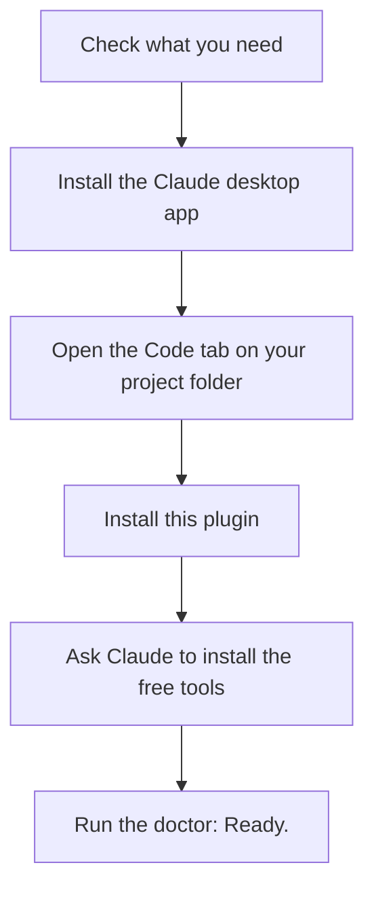

# 1. Install everything

**[Home](../../../README.md)** · [All guides](README.md) · [Next: 2. Your first demo video](02-your-first-demo-video.md)

You do this once. It takes 15 to 30 minutes. You will use the **Claude desktop app** the whole time. You do not need to type commands into a terminal: you ask Claude, and Claude does the technical parts.



## What you need

| Thing | Why | Cost |
| --- | --- | --- |
| A Mac or Windows computer | Runs the Claude desktop app (Linux is in beta) | |
| A Claude **Pro, Max, Team or Enterprise** plan | The Code tab (Claude Code) is not included in the free plan ([setup docs](https://code.claude.com/docs/en/setup)) | Paid Claude plan |
| The app you want to record, running somewhere you can open in a browser | It is what gets captured | |
| For voice later: an ElevenLabs account | Makes the narrator voice | Free to try. **Selling the audio to clients needs a paid plan**: the free plan has no commercial license ([ElevenLabs help](https://help.elevenlabs.io/hc/en-us/articles/13313564601361)) |
| For AI intro clips later (optional): a Replicate account | Makes intro videos | Pay per clip. See [4. Finish your video in ChatGPT](04-finish-in-chatgpt.md#what-is-replicate) |

## Step 1. Install the Claude desktop app

1. Go to the [Claude desktop download page](https://code.claude.com/docs/en/desktop) and download the app for your computer (Mac, or Windows x64 or ARM64).
2. Open the installer and follow it like any other app.
3. Open Claude and sign in with your Claude account.

**Check:** you see the Claude app with a **Code** tab at the top.

## Step 2. Open the Code tab on your project

The **Code** tab is Claude Code inside the desktop app. It can read files and run tools on your computer, but only after you say yes.

1. Click the **Code** tab.
2. Before you type anything, click the **project folder** control (next to the environment selector) and choose the folder of the project you want to capture. If you do not have one, make an empty folder called `capture` in Documents and choose that.
3. Keep the environment on your own computer (local). Plugins do not run in cloud sessions.

**You will see** a chat box. Everything from here on is typed into that box.

**About permission pop-ups:** when Claude wants to install something or run a tool, the app asks you first. Read what it wants to do and click **Allow** if it matches what you asked for.

## Step 3. Install this plugin

This is the one time you paste two lines into the app's built-in terminal panel. It takes a minute.

1. Click **Terminal** in the app's title bar (or press Ctrl and the backtick key, `` ` ``). A small panel opens inside the app.
2. Paste this line and press Enter. It tells Claude where Legion Code's plugins live:

   ```text
   claude plugin marketplace add legioncodeinc/app-auditor-plugin-claude
   ```

3. Paste this line and press Enter. It installs the plugin for your user, so it works in every project:

   ```text
   claude plugin install webapp-capture@legioncodeinc
   ```

4. Start a new session in the Code tab so the plugin loads.

**Check:** click the **+** button next to the chat box, then **Plugins**, then **Manage plugins**. You should see **webapp-capture** in the list. ([Install plugins](https://code.claude.com/docs/en/plugins/install), [desktop docs](https://code.claude.com/docs/en/desktop))

**Why the terminal panel for this step:** the desktop **Plugins** screen lists marketplaces you already added. Adding a new one from GitHub is documented with these two lines. Your plugin choice is shared by the desktop app and Claude Code everywhere, so you only do this once.

**What gets installed:** the `/webapp-capture` command, two skills (instructions Claude follows), a helper agent, and a small video tool connection (an MCP server) for Replicate. On first use, the plugin also downloads its script helpers (Playwright and sharp) and a copy of the Chromium browser. The full list is in [What it installs](USAGE-GUIDE.md#what-it-installs).

## Step 4. Ask Claude to install the free tools

The plugin needs three free tools: **Node.js** (runs the capture scripts), **ffmpeg** (builds the video files), and **Python** (only for the voice, intro and final stitch). Type:

```text
Check whether Node.js 20.9 or newer, ffmpeg, and Python 3.11 or newer are installed. Install any that are missing, explain each step in plain words, and ask me before installing anything.
```

**You will see** Claude check each tool, then ask permission to install what is missing. On a Mac it usually uses [Homebrew](https://brew.sh); on Windows it uses winget.

**If your computer asks for your password:** Claude cannot type passwords, and you should never paste one into the chat. Claude will tell you the exact line to run. Open the **Terminal** panel (title bar, or Ctrl and backtick), paste the line, and type your password there yourself.

**Windows note:** also ask Claude to install **Git for Windows** ([git-scm.com](https://git-scm.com)). The desktop app uses Git, and its Git Bash runs the video assembly script (`make-video.sh`). The Replicate intro tools work only on Mac and Linux, so on Windows use free stock B-roll for intros. (Plugins do not load in WSL sessions, so stay in a normal local session.)

## Step 5. Check that everything works

Type:

```text
/webapp-capture doctor demo
```

**You will see** a list of checks marked `ok`, `WARN` or `ERROR`. Claude explains and fixes anything marked `ERROR`. If it asks to install the Chromium browser, click **Allow**.

**Done when** the list ends with `Ready.`

**If stuck:** see [6. Fix problems](06-fix-problems.md#installing).

## Prefer a terminal?

Everything above also works in Claude Code in a terminal. Install it with the [official setup docs](https://code.claude.com/docs/en/setup), type `claude` in your project folder, and use the same prompts. Install the plugin there with `claude plugin marketplace add legioncodeinc/app-auditor-plugin-claude` and `claude plugin install webapp-capture@legioncodeinc`.

## What's next

Make your first video: [2. Your first demo video](02-your-first-demo-video.md).

**[Home](../../../README.md)** · [All guides](README.md) · [Next: 2. Your first demo video](02-your-first-demo-video.md)
