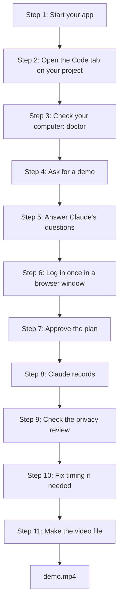

# 2. Your first demo video

**[Home](../../../README.md)** · [All guides](README.md) · [Previous: 1. Install everything](01-install-everything.md) · [Next: 3. Screenshots, library and audit](03-screenshots-library-audit.md)

In this guide you make a 60 to 90 second video of your app, with captions, from start to finish. It takes about 30 to 60 minutes the first time. Most of that is Claude working while you wait.

**Before you start:** finish [1. Install everything](01-install-everything.md). You need the Claude desktop app, this plugin, and ffmpeg.

## The whole trip



## Step 1. Start your app

The plugin records your app the way a visitor sees it, so the app has to be running and reachable in a web browser.

- **If you build the app on your computer:** start it the way you normally do. Not sure how? Ask Claude in the Code tab: "start my app and tell me its address". It usually shows an address like `http://localhost:3000`. "localhost" means "this computer". Write the address down.
- **If the app is already online:** use a test copy if you have one, such as `https://staging.yourapp.com`. Recording your real live site works too, but then real customer data can show up on screen.
- **Use a test account with sample data.** Empty accounts make boring videos, and real customer names should not end up in a video.

**Check:** open the address in your normal web browser. You should see your app.

## Step 2. Open the Code tab on your project

1. Open the Claude desktop app and click the **Code** tab.
2. Before you type anything, click the **project folder** control and choose your project's folder (see [1. Install everything, step 2](01-install-everything.md#step-2-open-the-code-tab-on-your-project)).
3. Start a new session.

**You will see** a chat box. Everything from here on is typed into that box.

## Step 3. Check your computer

Type:

```text
/webapp-capture doctor demo
```

**You will see** a list of checks marked `ok`, `WARN` or `ERROR`, each with a fix. Claude fixes most of them for you. If it asks to install something (like Chromium, the browser it records with), click **Allow**.

**Done when** the list ends with `Ready.`

## Step 4. Ask for a demo

Type `/webapp-capture demo`, your app's address, and what the video should show, in normal words:

```text
/webapp-capture demo http://localhost:3000 a 60 second video for new customers showing how to book a job
```

More examples are in [Common prompts](../../../README.md#common-prompts-copy-and-paste).

## Step 5. Answer Claude's questions

Claude asks everything it needs in one round. Typical questions:

| Question | What to answer |
| --- | --- |
| Which environment is this? | local, staging, a demo account, or production |
| What page opens right after you log in? | The real one, for example `/schedule` |
| Light or dark theme? | What you want the video to show |
| Where should files go? | The default, `library/design/`, is fine |
| What should be hidden? | Anything private: customer names, emails, keys, billing |
| Who is the video for, and how long? | For example: new customers, 60 seconds |
| What must it show? | The 2 or 3 things that matter most |
| Does the demo change any data? | For example: books one appointment. Say no if it should only look around. |

## Step 6. Log in once

Claude opens a real browser window at your app's login page.

1. Log in yourself. Two-step codes and "Sign in with Google" work.
2. Do not close the window. It closes by itself once you are in.

**Why:** Claude never sees or types your password. It only saves the "you are logged in" cookie, in a private file that is kept out of git.

**If stuck:** if the window says it timed out, ask Claude to "run the login step again".

## Step 7. Approve the plan

Claude runs a small test, then shows you:

- **the script**: what the narrator will say in each scene,
- **the plan**: each scene's page and actions (click, type, drag, scroll), and
- **the writes**: every change to your data, with what should happen. For example: "Creates one appointment on Tuesday, assigned to Sam".

Read them. Ask for changes in normal words ("make scene 2 shorter", "do not open the billing page"). When it looks right, type **yes, approved**. Nothing records before you approve, and each data change needs your yes.

## Step 8. Claude records

Each scene is recorded in its own browser, one after the other. This takes a few minutes. You do not need to watch.

After every data change, Claude checks the page to prove it worked. If a check fails, Claude stops making more changes, takes a screenshot, and writes it down in `findings.md` for you to look at. Scenes that only look around keep going.

**You will see** a short report: which scenes passed, which failed, and where the files are.

## Step 9. Check the privacy review

Type:

```text
Run the privacy review on the demo
```

Claude makes a contact sheet (one picture with a grid of frames) for each scene, and a list of any emails or phone numbers that showed on screen, masked like `d***@***.com`.

1. Open the `review` folder inside your demo folder.
2. Look at every picture. Watch for names, emails, phone numbers and pop-ups.
3. If something private shows, tell Claude what to hide, then ask for a retake (see below).

## Step 10. Fix the timing (if needed)

Claude checks if each narration line fits in its scene. If one is too long, it says **OVERRUN**. Type something like:

```text
Narration is too long in scene 2. Shorten the line and rebuild the captions.
```

## Step 11. Make the video file

Type:

```text
Make the final video file
```

Claude runs `make-video.sh`, which joins the scenes, holds the last frame for 1.5 seconds, and adds captions.

**You will find** `demo.mp4` in `library/design/demo/<your-video-title>/`. Double-click it to watch. Captions can be turned on in your video player.

## Need a retake?

Type `Retake the demo. I reset the test data.` Each take goes in its own folder, so nothing is overwritten. If the first take already made data changes, Claude lists them and asks before making them again. Reset your test data first, or let Claude pick new free slots.

## What's next

- Add a voice and an intro clip in ChatGPT: [4. Finish your video in ChatGPT](04-finish-in-chatgpt.md)
- Something went wrong: [6. Fix problems](06-fix-problems.md)

**[Home](../../../README.md)** · [All guides](README.md) · [Previous: 1. Install everything](01-install-everything.md) · [Next: 3. Screenshots, library and audit](03-screenshots-library-audit.md)
