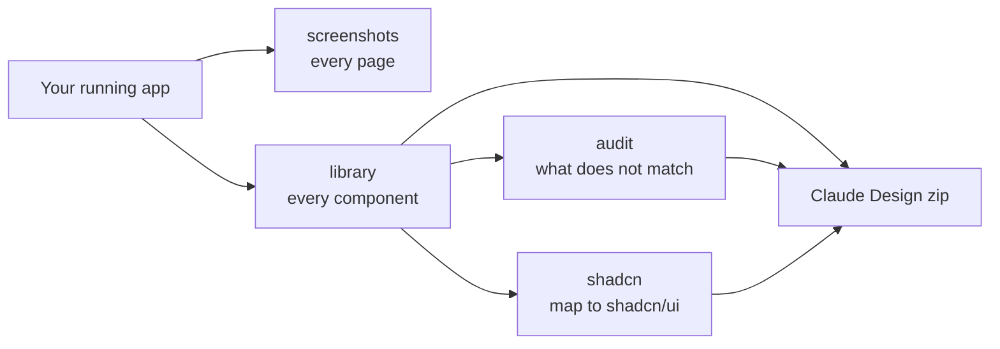

# 3. Screenshots, library and audit

**[Home](../../../README.md)** · [All guides](README.md) · [Previous: 2. Your first demo video](02-your-first-demo-video.md) · [Next: 4. Finish your video in ChatGPT](04-finish-in-chatgpt.md)

The plugin can do more than videos. This guide covers the other four jobs. They start the same way as a demo: your app is running, you open the **Code** tab of the Claude desktop app on your project folder, and you type a `/webapp-capture` command. Steps 1 to 6 of [2. Your first demo video](02-your-first-demo-video.md) (start the app, open the Code tab, doctor, ask, answer questions, log in) are the same here.



These jobs only look at your app. They open pages, scroll, and switch tabs. They never fill in forms or change settings.

## Screenshots: a picture of every page

```text
/webapp-capture screenshots http://localhost:3000
```

**What happens:** Claude finds every page in your app's main menu and takes pictures from the top to the bottom of each page, including each tab.

**You get:** `library/design/screenshots/<page>/` with files named after the page, like `dashboard-billing-001.png`.

**Good for:** documentation, app store listings, design reviews, and "before" pictures before a redesign.

## Library: every component, documented

```text
/webapp-capture library http://localhost:3000 try 3 pages first and show me
```

A **component** is a reusable piece of the screen: a button, a card, a menu, a table.

**What happens:**

1. Claude measures every element on every page (sizes, colors, fonts, spacing).
2. It groups the ones that look the same.
3. Several AI helpers describe each group at the same time (this is where parallel agents save a lot of time).
4. Claude merges the descriptions into one folder per component.

**You get:** `library/design/components/<name>/` with a description, the HTML, measured styles and screenshots, plus `candidate.tokens.json`: your app's colors, font sizes and spacing as **design tokens** (named values a designer or AI can reuse).

**Tip:** start with "try 3 pages first and show me". Check the sample, then ask for the full run.

## Audit: what does not match

```text
/webapp-capture audit http://localhost:3000 the code is in ./web
```

**What happens:** Claude compares everything it measured and looks for things that should be the same but are not: seven slightly different whites, buttons drawn five ways, spacing that does not follow a pattern. If you tell it where the code is, it also finds the lines that cause each problem.

**You get:** dated reports in `library/requirements/reports/`, sorted by how much each problem matters.

## shadcn: move your look to shadcn/ui

```text
/webapp-capture shadcn http://localhost:3000
```

[shadcn/ui](https://ui.shadcn.com) is a popular set of ready-made components for React apps. This job maps each of your components to the closest shadcn/ui one.

**You get:** `library/design/shadcn/SHADCN-MAP.md` (the map and the exact install command) and `globals.css` (a theme that makes shadcn/ui look like your app).

## Claude Design handoff

After the library, audit or shadcn job, Claude also builds one zip file: `library/design/<app>-claude-design-handoff-<date>.zip`. Upload it to Claude Design and type "Read CLAUDE-DESIGN-INSTRUCTIONS.md and follow it" to get a brand guide and design system.

## Everything at once

```text
/webapp-capture all https://staging.yourapp.com
```

Runs library, audit, shadcn and demo in that order, then the handoff zip. Claude reports after each one, so you can stop early.

## What's next

- Turn this into paid work: [5. Make money with it](05-make-money.md)
- Something went wrong: [6. Fix problems](06-fix-problems.md)

**[Home](../../../README.md)** · [All guides](README.md) · [Previous: 2. Your first demo video](02-your-first-demo-video.md) · [Next: 4. Finish your video in ChatGPT](04-finish-in-chatgpt.md)
