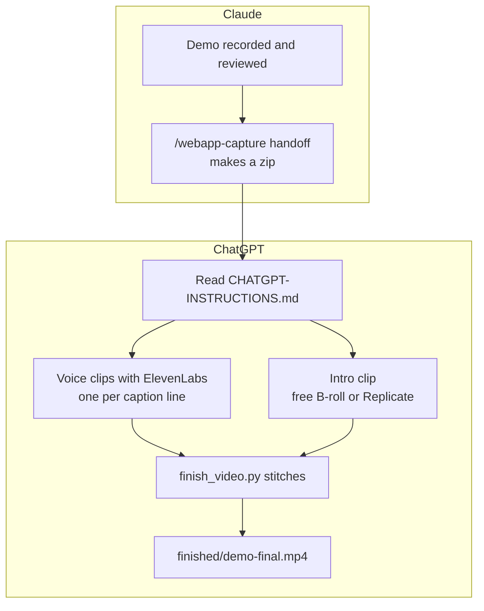

# 4. Finish your video in ChatGPT

**[Home](../../../README.md)** · [All guides](README.md) · [Previous: 3. Screenshots, library and audit](03-screenshots-library-audit.md) · [Next: 5. Make money with it](05-make-money.md)

Claude recorded your app and made a silent video with captions. Now ChatGPT adds three things: a narrator voice, a short intro clip, and the final stitch that joins them. It takes 20 to 40 minutes.

**Before you start:** you have a finished demo from [2. Your first demo video](02-your-first-demo-video.md), including the privacy review.



The voice clips and the intro do not depend on each other, so ChatGPT makes them at the same time. Only the stitch needs both.

## What you need

| Thing | Notes |
| --- | --- |
| The ChatGPT desktop app, using **Work mode** or **Codex** | Local plugins are installed there ([OpenAI docs](https://developers.openai.com/plugins/build/plugins)). Whether your plan or workspace can install plugins depends on your plan, role and region ([OpenAI help](https://help.openai.com/en/articles/20001256-plugins-in-chatgpt)). |
| An ElevenLabs account | For the voice. **For client work, use a paid plan.** The free plan has no commercial license ([ElevenLabs help](https://help.elevenlabs.io/hc/en-us/articles/13313564601361)). |
| ffmpeg and Python 3.11 or newer | Already done if you followed [1. Install everything](01-install-everything.md) |
| A Replicate account and token | **Only** for AI-made intro clips. Free stock B-roll needs none. See [What is Replicate?](#what-is-replicate) below. |

## Step 1. In Claude: make the handoff zip

In Claude Code, type:

```text
/webapp-capture handoff
```

Claude asks a few questions about the intro (do you want one, stock or AI-made, what the product does, who it is for, brand colors). Then it builds `<your-demo>-chatgpt-handoff.zip` next to your demo folder.

**What is inside:** the silent video, the captions, one text file per narrator line, an intro brief, step-by-step instructions for ChatGPT (`CHATGPT-INSTRUCTIONS.md`), and the stitch script (`finish_video.py`).

**If it refuses:** it will not build the zip until the privacy review exists, because the zip leaves your computer. Run the review first ([guide 2, step 9](02-your-first-demo-video.md#step-9-check-the-privacy-review)).

## Step 2. Install this plugin in ChatGPT (once)

The same plugin folder works in ChatGPT. It gives ChatGPT the intro video skill and the Replicate video tools.

1. Get the plugin's files on your computer. Open [the plugin's GitHub page](https://github.com/legioncodeinc/app-auditor-plugin-claude), click the green **Code** button, then **Download ZIP**. Unzip it somewhere you will keep it, like your Documents folder.

   This folder has a plugin list ChatGPT reads (`.agents/plugins/marketplace.json`).
2. Open that folder in the ChatGPT desktop app's Work mode or Codex.
3. Restart the ChatGPT desktop app.
4. Open the **Plugins Directory**, choose **Legion Code Inc. Plugins**, and install **Webapp Capture Video Studio**.

These steps follow OpenAI's local plugin docs ([build plugins](https://developers.openai.com/plugins/build/plugins)). OpenAI is still changing this feature, so the menu names may differ slightly in your version.

## Step 3. Connect ElevenLabs (once)

1. Go to [elevenlabs.io/mcp](https://elevenlabs.io/mcp) and use its **Add to ChatGPT** option. You sign in with your ElevenLabs account, so you never paste a key into ChatGPT.
2. If your setup asks for an API key instead, create one at [elevenlabs.io/app/settings/api-keys](https://elevenlabs.io/app/settings/api-keys) and put it in the connector's settings, never in a chat message.
3. Pick a voice in ElevenLabs that you like. Use a stock voice, or a voice clone the client gave written permission for. Never copy a real person's voice without consent.

## Step 4. Replicate token (only for AI-made intros)

Skip this step if you will use free stock B-roll.

### What is Replicate?

[Replicate](https://replicate.com) is a website that runs AI models for you in the cloud. Video models like Google Veo, Kling and Wan need huge, expensive computers. Replicate owns those computers and rents you a few seconds of time on them. This plugin talks to Replicate for you, so you never have to use its website to make a clip.

**Do I need it?** Only if you want an AI-made intro clip. Free stock B-roll does not need Replicate. Everything else in this plugin works without it.

**What does it cost?** You pay only for what you use ([billing](https://replicate.com/docs/topics/billing)). Each model shows its price on its page on replicate.com, and video models cost much more than image models, so check the price before you render. A few models can be tried for free, but after a bit Replicate asks you to set up billing (a card, or prepaid credit). If a run fails, you are not charged. If you cancel a run partway, you may still be charged for the time it ran. The plugin always asks before any paid render.

### Get your Replicate token (about 3 minutes)

A token is a long password that lets this plugin use your Replicate account. It starts with `r8_`. Treat it like a bank card number.

1. Go to [replicate.com](https://replicate.com) and sign up (or sign in).
2. Set up billing on the [billing page](https://replicate.com/account/billing) (a card, or prepaid credit). Video models will not run without it.
3. Open [replicate.com/account/api-tokens](https://replicate.com/account/api-tokens). Replicate makes a default token when you sign up. You can use it, or click to create a new one named `webapp-capture` so you can turn it off later without breaking anything else.
4. Copy the token.
5. Save it in **one** of these places. Never paste it into a chat with Claude or ChatGPT.
   - **Claude desktop app (or Claude Code):** open the **Terminal** panel (title bar, or Ctrl and backtick), run `claude plugin configure webapp-capture@legioncodeinc`, and paste the token into the private field. Claude keeps it in your computer's secure credential store. Start a new session.
   - **ChatGPT:** open your computer's Terminal app (or the Claude app's Terminal panel), go to this plugin's folder, and run `python3 mcp/replicate-video/scripts/set_token.py --check`. Paste the token when it asks. The typing is hidden. The `--check` part makes one free, read-only call to confirm the token works. It saves the token to `~/.config/webapp-capture/replicate.env`, a file only you can read. Restart the app. Not sure where the plugin folder is? Ask Claude or ChatGPT: "Where is the webapp-capture plugin folder on this computer?"
   - **Advanced:** set `REPLICATE_API_TOKEN` in the environment that starts the app. It wins over the saved file.
6. Check it: ask Claude or ChatGPT to "check the Replicate video connection without generating anything." This runs the production doctor. It says whether a token is there but never shows it.

**Lost it or leaked it?** Delete that token on [replicate.com/account/api-tokens](https://replicate.com/account/api-tokens), make a new one, and save it again. To remove it from this computer, run `python3 mcp/replicate-video/scripts/set_token.py --remove`.

## Step 5. In ChatGPT: finish the video

1. Unzip the handoff zip.
2. In ChatGPT (Work mode or Codex), open the unzipped folder, and type:

   ```text
   Read CHATGPT-INSTRUCTIONS.md and finish this demo video. Use free stock B-roll for the intro unless I say otherwise. Ask me before anything that costs money.
   ```

3. Answer ChatGPT's questions: which voice, and which intro clip you like.

**What ChatGPT does:**

1. Makes one voice clip per caption line with ElevenLabs, and checks each one fits its line.
2. Finds 2 or 3 free B-roll clips for you to pick from (or, if you asked, renders one with a Replicate model after telling you the cost).
3. Checks the intro frame by frame for warped hands, melted objects or fake text.
4. Runs `python3 finish_video.py --intro intro/intro.mp4`. That puts the intro first, lines up each voice clip with its caption, moves the captions to match, and saves `finished/demo-final.mp4`.

## Step 6. Check the final video

Open `finished/demo-final.mp4` and watch it all the way through with sound.

- Each voice line should match what is on screen.
- Captions should line up with the voice.
- The intro should be clean, with no logos or strange frames.

Want a change? Tell ChatGPT in normal words, for example "Line 3 is too long. Shorten it, make the voice again, and stitch again." The stitch never overwrites, so ChatGPT renames the old `finished` folder first.

## Free B-roll sites

Most intros do not need custom footage. These sites let you use clips in paid client videos for free (checked 2026-10-23):

| Site | Free for client work | Credit needed | Good to know |
| --- | --- | --- | --- |
| [Pexels](https://www.pexels.com/videos/) | Yes ([license](https://www.pexels.com/license/)) | No | Has a free [API](https://www.pexels.com/api/documentation/) an AI agent can search. Up to 4K. |
| [Pixabay](https://pixabay.com/videos/) | Yes ([license](https://pixabay.com/service/license-summary/)) | No | Has a free [API](https://pixabay.com/api/docs/). No clips with brands for commercial use. Up to 4K. |
| [Mixkit](https://mixkit.co/free-stock-video/) | Yes, for clips marked Free License ([license](https://mixkit.co/license/)) | No | Some clips are personal use only, so check the label. Do not bulk download with scripts. |
| [Coverr](https://coverr.co/) | Yes ([license](https://coverr.co/license)) | No | Logos in clips need separate permission. |
| [Vecteezy](https://www.vecteezy.com/free-videos) | Limited ([license](https://www.vecteezy.com/licensing-agreement)) | Yes, on free clips | Free clips are capped at a $1,000 production budget. |
| [Videezy](https://www.videezy.com/) | Yes ([license](https://support.videezy.com/en_us/videezy-standard-license-and-usage-HylDtxsDK)) | Yes, on free clips | Add a credit line. |

Rules that keep you safe:

- Save the clip link, the creator, the license and the date for every clip you use.
- Skip clips with logos, brand names, or a person who would look like they endorse the product.
- Give the client the finished video, never the raw stock clips.

Need something custom? The `demo-intro-video` skill can generate an intro with a Replicate model instead. That costs money per clip. The full list with API limits is in [free-broll-sources.md](../skills/demo-intro-video/references/free-broll-sources.md).

## Prompts for ChatGPT

| Type this | What happens |
| --- | --- |
| `Check the Replicate video connection without generating anything.` | Runs the doctor. Nothing is paid for. |
| `Find 3 free B-roll clips for a 5 second intro about field service software. Show me before downloading.` | Searches free sites and shows choices. |
| `Generate a 6 second intro with Veo 3.1 from INTRO-BRIEF.md. Tell me the cost first.` | Writes the prompt and waits for your yes before the paid render. |
| `Line 3 is too long. Shorten it, regenerate the voice, and stitch again.` | Fixes one line and rebuilds. |

## What's next

- Sell this work: [5. Make money with it](05-make-money.md)
- Something went wrong: [6. Fix problems](06-fix-problems.md#chatgpt-voice-and-intro)

**[Home](../../../README.md)** · [All guides](README.md) · [Previous: 3. Screenshots, library and audit](03-screenshots-library-audit.md) · [Next: 5. Make money with it](05-make-money.md)
