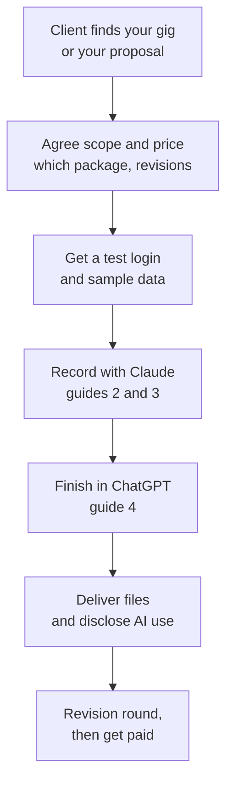

# 5. Make money with it

**[Home](../../../README.md)** · [All guides](README.md) · [Previous: 4. Finish your video in ChatGPT](04-finish-in-chatgpt.md) · [Next: 6. Fix problems](06-fix-problems.md)

People and companies pay for demo videos, screenshot sets, UI audits and design system work. This plugin does most of the work, so you can sell it as a service on Upwork or Fiverr. This guide shows what to charge, what the sites take, and how to set up your offers.

## How a job goes

1. **Agree the scope in writing.** Which package, how many revisions, and the delivery date.
2. **Ask for a test login, not their password.** A staging site or a demo account with sample data. If they only have a live site, agree in writing what will be on screen.
3. **Record and check.** Follow [2. Your first demo video](02-your-first-demo-video.md). Always run the privacy review before you send anything.
4. **Finish.** Follow [4. Finish your video in ChatGPT](04-finish-in-chatgpt.md) for the voice and intro.
5. **Deliver.** Send the final video, the screenshots or reports, and a short note on which parts used AI.
6. **One revision round,** as agreed, then mark the order complete.

People pay for demo videos, screenshot sets, UI audits and design system work. This plugin does most of the hard part, so you can sell it as a service. The prices below come from real Upwork and Fiverr listings checked on 2026-10-23. Prices change, so check them before you set yours.

## What to charge

| Service | Fiverr (starting prices seen) | Upwork (seen) | Suggested price |
| --- | --- | --- | --- |
| 60 to 90 second demo video with captions | $10 to $390, middle about $70 ([listings](https://www.fiverr.com/gigs/saas-demo-video)) | $75 to $350 catalog tiers, one real job paid $1,500 ([catalog](https://www.upwork.com/services/product/video-audio-saas-explainer-video-saas-product-demo-software-2d-animation-2104267940207069222)) | $250 to $900 on Fiverr, $400 to $1,500 on Upwork |
| App walkthrough or tutorial video | $5 to $240, middle about $30 ([listings](https://www.fiverr.com/gigs/saas-tutorial-video)) | $49 to $1,000 ([catalog](https://www.upwork.com/services/product/video-audio-saas-onboarding-and-how-to-videos-for-your-product-with-ai-voiceover-2104584812256255571)) | $150 to $600 |
| AI voiceover add-on | $5 to $80 ([category](https://www.fiverr.com/categories/music-audio/voice-synthesis-ai)) | about $40 add-on | $25 to $75 extra |
| UI/UX audit of a web app | $10 to $500, middle about $73 ([listings](https://www.fiverr.com/gigs/ux-audit)) | $500 to $1,800, top sellers up to $4,200 ([catalog](https://www.upwork.com/services/product/design-a-ux-audit-of-your-website-web-app-or-saas-dashboard-fix-roadmap-2074474334902230300)) | $350 to $1,800 |
| Component library or design system docs | $120 to $900 ([example gig](https://www.fiverr.com/ariftarkandilek/build-a-design-system-with-tokens-components-and-docs)) | UI designers $20 to $40 an hour ([rates](https://www.upwork.com/hire/ui-designers/cost/)) | $500 to $2,500 |
| shadcn/ui migration map | no direct gigs found | no direct listings found | $400 to $2,000 as a premium add-on (estimate) |
| Screenshot set for docs or app stores | $5 to $625, middle about $35 | $40 to $80 catalog tiers | $75 to $300 |
| Everything as one bundle | | | $900 to $2,500 on Fiverr, $1,500 to $4,000 on Upwork (estimate) |

"Suggested price" is our estimate built from the listings. Fiverr tag pages show each seller's cheapest package, so real orders are usually higher.

## Fees you pay

- **Fiverr** keeps 20%, so you get 80% of every order and tip. Money clears after 14 days (7 for Top Rated sellers). Buyers pay their own 5.5% fee, plus $3.50 on orders under $200. ([Fiverr payment terms](https://www.fiverr.com/legal-portal/legal-terms/payment-terms-of-service))
- **Upwork** takes a fee from 0% to 15% per contract. You see the rate before you accept. It is lower on Direct Contracts with clients you bring yourself. ([Upwork fee](https://support.upwork.com/hc/en-us/articles/211062538)) Sending a proposal costs Connects, which are $0.15 each. ([Connects](https://support.upwork.com/hc/en-us/articles/211062898-Understanding-and-using-Connects))

## How to sell it

1. **Make three packages on Fiverr.** For example:
   - Basic: screenshot set plus a 30 second clip.
   - Standard: a 60 to 90 second narrated demo with captions.
   - Premium: Standard plus the component library, the UI audit and the shadcn/ui map.

   Start Basic at $200 or more, so buyers skip the small-order fee. ([Creating a gig](https://help.fiverr.com/hc/en-us/articles/360010451397-Creating-a-Gig))
2. **Sell extras instead of unlimited changes.** Offer extra revisions, rush delivery, a second language, or an intro clip. ([Gig extras](https://help.fiverr.com/hc/en-us/articles/360014487758))
3. **On Upwork, list the bundle in the Project Catalog** with three tiers, and bid only on jobs that fit, because each bid costs Connects.
4. **Build a portfolio from a sample app.** Show one demo video, one page of an audit, a design token sheet and part of a shadcn/ui map. Use your own sample app or a client who agreed to it.
5. **Set the revision rules up front.** For example: two rounds on the script before recording, and one round on the final cut. A redesign of the app means a new order.
6. **Be honest about AI.** Fiverr requires you to follow a client's "no AI" request and to say how you work when asked. Misleading clients can get your account banned. Use stock AI voices or a voice the client approved. Never copy a real person's voice without consent. ([Fiverr AI rules](https://help.fiverr.com/hc/en-us/articles/34998793899665)) Upwork bars AI use when your client restricts it. ([Upwork terms](https://www.upwork.com/legal)) Simple rule: write "AI-assisted capture, narration and intro" in every offer.
7. **Use test data.** Record on a staging copy or a demo account, not the client's live customers. The plugin's privacy review helps, but you are still responsible for what is on screen.
8. **Use paid licenses for client work.** ElevenLabs' free plan has no commercial license, so use a paid plan for voices you sell ([ElevenLabs help](https://help.elevenlabs.io/hc/en-us/articles/13313564601361)). Free stock B-roll must follow each site's license ([free B-roll sources](../skills/demo-intro-video/references/free-broll-sources.md)).
9. **Count your costs.** Voice (ElevenLabs) and generated intros (Replicate) cost money per use. Free stock B-roll does not. Add paid costs to the price, or pass them through.

This section is general business information, not legal or tax advice.

**[Home](../../../README.md)** · [All guides](README.md) · [Previous: 4. Finish your video in ChatGPT](04-finish-in-chatgpt.md) · [Next: 6. Fix problems](06-fix-problems.md)
