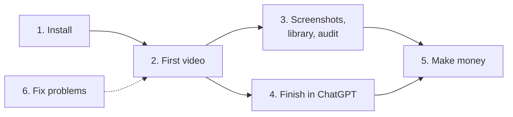

# Webapp Capture guides

**[Home](../../../README.md)** · [Branded PDF of all guides](webapp-capture-usage-guide.pdf)

Read these in order the first time. Each one links to the next.

| # | Guide | What you will do | Time |
| --- | --- | --- | --- |
| 1 | [Install everything](01-install-everything.md) | Install the Claude desktop app, this plugin, and the free tools it needs | 15 to 30 min, once |
| 2 | [Your first demo video](02-your-first-demo-video.md) | Make a 60 to 90 second captioned video of your app | 30 to 60 min |
| 3 | [Screenshots, library and audit](03-screenshots-library-audit.md) | Capture every page, every component, and what does not match | 15 min to a few hours |
| 4 | [Finish your video in ChatGPT](04-finish-in-chatgpt.md) | Add a voice, an intro clip, and stitch the final video | 20 to 40 min |
| 5 | [Make money with it](05-make-money.md) | Price and sell this work on Upwork and Fiverr | 15 min to read |
| 6 | [Fix problems](06-fix-problems.md) | Find what you see and do what it says | as needed |

## Reference

- [Usage reference](USAGE-GUIDE.md): everything on one page, including what the plugin installs, the safety model, and where every file goes.
- [Free B-roll sources](../skills/demo-intro-video/references/free-broll-sources.md): free stock video sites, their licenses and APIs.
- [Intro prompts](../skills/demo-intro-video/guides/intro-prompts.md): how to ask an AI video model for a good opening shot.

## Technical guides (for Claude and power users)

Claude follows these step-by-step instructions while it works. You do not need to read them, but they explain exactly what happens:

- [00 Foundation](../skills/webapp-capture-stinger/guides/00-foundation.md): login, safety rules, how pages are found, naming
- [01 Demo video, screenshots and script](../skills/webapp-capture-stinger/guides/01-demo-video-screenshots-script.md): every demo action, writes, retakes, timing, narration
- [02 Component library](../skills/webapp-capture-stinger/guides/02-component-library-capture.md)
- [03 Inconsistency audit](../skills/webapp-capture-stinger/guides/03-inconsistency-audit.md)
- [04 shadcn/ui map](../skills/webapp-capture-stinger/guides/04-shadcn-map.md)
- [Script and config reference](../skills/webapp-capture-stinger/references/REFERENCE.md)
- [The /webapp-capture command](../commands/webapp-capture.md) and the [intro video skill](../skills/demo-intro-video/SKILL.md)
