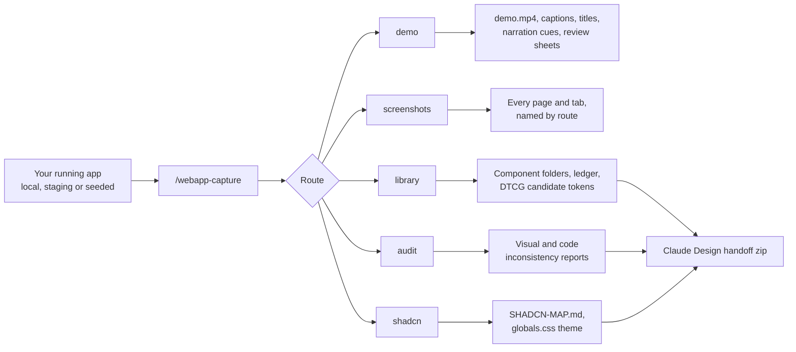
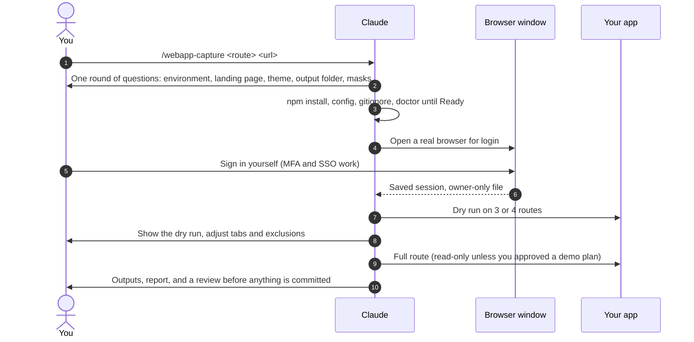
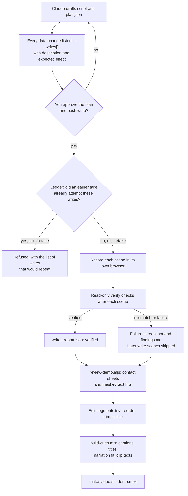
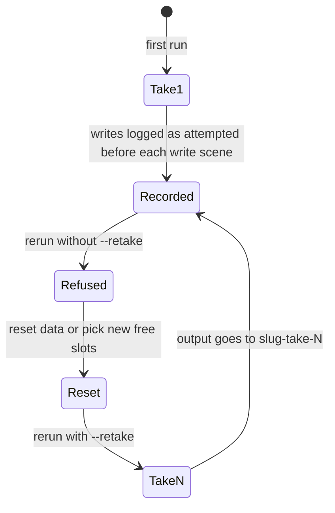
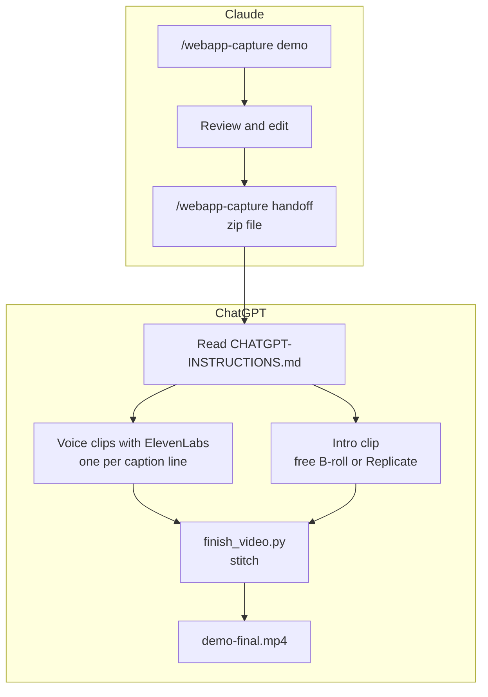
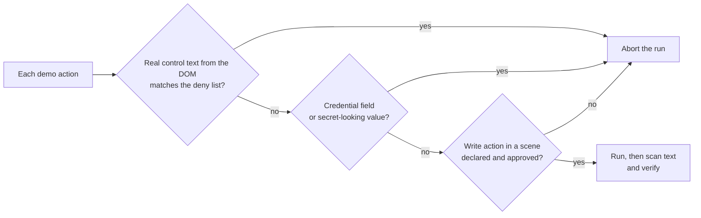

# Webapp Capture: Usage Reference

**Make Demo Videos & Audit My UX/UI with Claude.** Designed and built by [Legion Code Inc.](https://www.legioncodeinc.com)

Webapp Capture walks a running web app the way a user does and turns what it sees into things people and AI agents can build on: demo videos with captions and narration timing, organized screenshots, a documented component library with design tokens, a Claude Design handoff, a shadcn/ui map, and an audit of where the UI disagrees with itself.

This guide covers what the plugin installs, how a first run goes, what each route does, and how the demo recorder keeps your data safe.

**[Home](../../../README.md)** · [All guides](README.md) · [Branded PDF](webapp-capture-usage-guide.pdf)

This is the reference: everything on one page. **New here?** Follow the numbered guides instead, starting with [1. Install everything](01-install-everything.md).

## Contents

- [At a glance](#at-a-glance)
- [What it installs](#what-it-installs)
- [Your first run](#your-first-run)
- [The routes](#the-routes)
- [Demo route in depth](#demo-route-in-depth)
- [Common prompts (copy and paste)](#common-prompts-copy-and-paste)
- [Finish the video in ChatGPT](#finish-the-video-in-chatgpt)
- [What runs in parallel](#what-runs-in-parallel)
- [Free B-roll sites](#free-b-roll-sites)
- [Make money with it](#make-money-with-it)
- [Replicate (only for AI-made intro clips)](#replicate-only-for-ai-made-intro-clips)
- [How it stays safe](#how-it-stays-safe)
- [Where outputs go](#where-outputs-go)
- [Troubleshooting](#troubleshooting) (more in [6. Fix problems](06-fix-problems.md))

## At a glance



`/webapp-capture all` runs library, audit, shadcn, and demo in that order, then builds the Claude Design handoff.

## What it installs

Nothing is installed globally except the Chromium build Playwright uses. Everything else stays inside the plugin folder or your project.

| What | Where | When |
| --- | --- | --- |
| The `/webapp-capture` command, the `webapp-capture-stinger` skill, and the `webapp-capture-worker-bee` agent | Your Claude Code plugins folder | When you install the plugin |
| `playwright-core` and `sharp` (npm) | The skill's `scripts/node_modules/` | First run (`npm install` in `scripts/`) |
| Chromium for Playwright | Playwright's browser cache (for example `~/Library/Caches/ms-playwright` on macOS) | First run, only if `doctor` finds no Chromium |
| ffmpeg | Your system package manager | You install it; needed only to assemble demo videos and contact sheets |
| `capture.config.json` | Your project, next to the outputs (default `library/design/`) | Setup, filled in from your answers |
| Saved login session (`auth.json` and its `.session.json` sidecar) | A gitignored folder in your project, for example `.capture/` | When you log in once in the browser window |
| `.gitignore` lines for the session and raw capture data | Your project's `.gitignore` | Setup; Claude shows you the lines it adds |
| The `replicate_video` MCP server (Python, standard library only) | The plugin's `mcp/replicate-video/` folder; Claude Code and ChatGPT start it with the plugin | Enabled with the plugin. It does nothing paid until you approve a generation, and it needs a token only to generate |
| Your Replicate token (optional) | Claude Code's secure credential store, or `~/.config/webapp-capture/replicate.env` (owner-only) | Only if you set one up; see [Replicate token](#get-your-replicate-token-about-3-minutes) |

### Requirements

| Need | Why | Install |
| --- | --- | --- |
| Node 20.9 or newer | Runs the capture scripts | [nodejs.org](https://nodejs.org) |
| Chromium for Playwright | Headless browser | `npx playwright install chromium` in the skill's `scripts/` folder (Claude does this when `doctor` asks) |
| Python 3.11 or newer | Replicate video tools and `finish_video.py` | [python.org](https://www.python.org) |
| ffmpeg | Demo assembly and review sheets | `brew install ffmpeg`, `apt install ffmpeg`, or `winget install ffmpeg` |
| A running copy of your app | The thing being captured | Local, staging, or a seeded demo account is best |

### Install the plugin

```bash
claude plugin marketplace add legioncodeinc/app-auditor-plugin-claude
claude plugin install webapp-capture@legioncodeinc
```

For Claude Cowork, upload the plugin zip from the repository's `dist/` folder. For claude.ai, upload the `.skill` file under Settings, Capabilities, Skills.

## Your first run

Start Claude Code in the project whose app you want to capture, with the app running.

```text
/webapp-capture doctor
/webapp-capture demo http://localhost:3000 onboarding flow for new admins
```



Claude asks for the real page your app opens right after sign-in (for example `/schedule`, not a guessed `/dashboard`). Route discovery and the first demo scene start there.

## The routes

| Route | Command | You get |
| --- | --- | --- |
| Demo | `/webapp-capture demo <url>` | A 1080p MP4 with soft captions, scene titles, key screenshots, a narration script with timing checks, one text-to-speech clip text per line, and a privacy review |
| Screenshots | `/webapp-capture screenshots <url>` | Every page and real tab, scrolled top to bottom, named by route |
| Component library | `/webapp-capture library <url>` | One folder per unique component (purpose, anatomy, variants, measured styles, markup, screenshots), a ledger, and DTCG candidate tokens |
| Inconsistency audit | `/webapp-capture audit <url>` | Near-duplicate colors, sprawling type and spacing scales, component drift, contrast, and the hardcoded values behind them |
| shadcn/ui map | `/webapp-capture shadcn <url>` | Each component mapped to shadcn/ui, the install command, and an OKLCH `globals.css` theme |
| Everything | `/webapp-capture all <url>` | All of the above, then the Claude Design handoff zip |
| Check setup | `/webapp-capture doctor` | What is missing on this machine and the exact fix for each item |

## Demo route in depth

A demo is the one route that may change your app, so it has the most guard rails. Claude drafts a script and a plan, you approve them, and the recorder proves each change it makes.



### Plan actions

| Action | What it does |
| --- | --- |
| `wait`, `hover`, `click`, `type`, `scroll` | The basics. Clicks and typing are checked against the deny list, and credential fields are always refused |
| `select` | Picks a dropdown option by its visible label |
| `check`, `uncheck` | Ticks or unticks a checkbox, for example untick Repeats |
| `drag` | Pointer drag between elements or points, in small steps, for drag-and-drop libraries |
| `dragTo` | Native HTML drag and drop |
| `scrollElement` | Scrolls a container such as a calendar grid, or brings a target time into view |
| `waitFor` | Waits for live state (a selector or text) instead of a fixed delay |
| `confirmDialog` | Clicks the named button only if the dialog says what the plan expects; otherwise cancels and stops the scene |

After a scene, `verify` checks (visible, hidden, text, count) read the page without touching it.

### Writes, takes and retakes



- Every take is remembered in `<output.demo>/<slug>.ledger.json`. Takes never overwrite each other.
- A rerun that would repeat earlier writes is refused and lists them. You decide whether to reset the data and run again with `--retake`.
- Pick slots from live state: wait for a free slot by selector, drop onto that same selector, then verify by counting. Never hardcode "Tuesday 9:00".
- After a write mismatch or failure, later write scenes are skipped so one bad drop does not cascade. Read-only scenes keep running.

### Privacy review

Pixels can show what text redaction cannot, such as an email in a hover card. During recording, each page's visible text is scanned for emails, phone numbers, and your `redact.patterns`. Only masked hits are stored (for example `d***@***.com`). Then:

```bash
CAPTURE_CONFIG=... DEMO_DIR=<demo folder> node <skill>/scripts/demo/review-demo.mjs
```

writes one contact sheet per scene and `review/REVIEW.md`. A person checks every tile before the video is shared.

### Editing and narration

- `segments.tsv` is the edit list: one clip per line with in and out points. Reorder, delete, trim, or splice a clip from another take under `clips/`. Failed and mismatched scenes are left out by default.
- `build-cues.mjs` rebuilds `captions.vtt`, `titles.srt`, `narration/fit.md`, and the clip texts after every edit.
- `narration/fit.md` checks each line against the time its scene is on screen at the plan pace (140 words per minute by default) and flags overruns.
- Text to speech for Eleven v4: one clip per line, bracketed tags like `[pause]` and `[warm]` kept, SSML `<break>` converted to tags, and domains spelled out ("app dot example dot com"). No model id is hardcoded; your API key stays in your own secret manager.
- `make-video.sh` refuses linked inputs and existing outputs, cuts and normalizes each segment to 1080p H.264, holds the last frame (`video.endHoldMs`, default 1.5 seconds), and adds soft captions.

## Common prompts (copy and paste)

You talk to the plugin by typing `/webapp-capture`, then what you want, then your app's web address. Write the rest like you would tell a coworker. Claude asks about anything it needs before it starts.

Swap `http://localhost:3000` for your own app's address.

### Get set up

| Type this | What happens |
| --- | --- |
| `/webapp-capture doctor` | Checks your computer. It lists anything missing and the exact fix. Run this first. |
| `/webapp-capture doctor demo` | The same check, plus the tools needed to make videos (ffmpeg). |

### Make a demo video

| Type this | What happens |
| --- | --- |
| `/webapp-capture demo http://localhost:3000 a 60 second video for new customers showing how to book a job` | Claude writes a script and a plan, shows them to you, and records only after you say yes. |
| `/webapp-capture demo http://localhost:3000 show the onboarding flow for a new admin, no data changes` | A demo that only clicks around and changes nothing. |
| `/webapp-capture demo http://localhost:3000 book one appointment on the first free Tuesday slot and assign Sam` | A demo that changes data. Claude lists each change for you to approve, then checks that each one worked. |
| `Retake the demo. I reset the test data.` | Records a new take in a new folder. Claude shows which changes will happen again before it starts. |
| `Run the privacy review on the demo` | Makes contact sheets (a grid of frames) and a list of emails and phone numbers that showed on screen, masked. You look at every frame. |
| `Narration is too long in scene 2. Trim the line and rebuild the captions.` | Shortens the words, then rebuilds captions and timing. |
| `/webapp-capture handoff` | Packs the finished demo into a zip for ChatGPT to add the voice, the intro and the final cut. See [Finish the video in ChatGPT](#finish-the-video-in-chatgpt). |

### Screenshots, components, audits

| Type this | What happens |
| --- | --- |
| `/webapp-capture screenshots http://localhost:3000` | A picture of every page and every tab, top to bottom. |
| `/webapp-capture screenshots http://localhost:3000 dark mode only, skip the settings pages` | Same, with your rules. |
| `/webapp-capture library http://localhost:3000 try 3 pages first and show me` | Starts the component library on a few pages so you can check it before the full run. |
| `/webapp-capture audit http://localhost:3000 the code is in ./web` | Finds UI that does not match (colors, spacing, buttons) and the code that causes it. |
| `/webapp-capture shadcn http://localhost:3000` | Maps your components to shadcn/ui and makes a matching theme. |
| `/webapp-capture all https://staging.myapp.com` | Everything, one step at a time. You can stop after any step. |

### Words you will see

- **Route**: one kind of job (demo, screenshots, library, audit, shadcn).
- **Plan**: the list of steps for a demo. Nothing records until you approve it.
- **Write**: a step that changes data in your app, like booking an appointment. Each one needs your yes.
- **Take**: one recording. A retake is a new recording in a new folder.
- **B-roll**: extra footage that is not your app, like a short opening shot.
- **MCP**: a plug-in connection that gives an AI new tools. This plugin includes one for Replicate video models.
- **Replicate**: a website that runs AI video models for a small fee per clip. See [What is Replicate?](#what-is-replicate)
- **Token**: a long password that lets a tool use your account. Keep it private.

## Finish the video in ChatGPT

Claude records your app. ChatGPT finishes the video: it adds the voice, the intro clip, and stitches it all together. Here is the whole trip.



**Step 1. In Claude: record and check.** Run the demo route, then the privacy review. Fix anything you do not want to show.

**Step 2. In Claude: make the handoff zip.** Type `/webapp-capture handoff`. You get `<demo>-chatgpt-handoff.zip`. It holds the silent video, the captions, one text file per voice line, a brief for the intro, a step-by-step `CHATGPT-INSTRUCTIONS.md`, and `finish_video.py`. It will not build the zip until the privacy review exists, because the zip leaves your computer.

**Step 3. In ChatGPT: set up once.**

- Install this plugin in the ChatGPT desktop app (Work mode or Codex). Steps: [guide 4, step 2](04-finish-in-chatgpt.md#step-2-install-this-plugin-in-chatgpt-once).
- Connect ElevenLabs with **Add to ChatGPT** on [elevenlabs.io/mcp](https://elevenlabs.io/mcp). Use a paid ElevenLabs plan for client work: the free plan has no commercial license.
- Only if you want AI-made intros: get a Replicate token and save it once. See [Get your Replicate token](#get-your-replicate-token-about-3-minutes). Never paste a key into a chat.
- Install ffmpeg and Python 3.11 or newer.

**Step 4. In ChatGPT: finish.** Attach the zip and type:

```text
Read CHATGPT-INSTRUCTIONS.md and finish this demo video. Use free stock B-roll for the intro unless I say otherwise. Ask me before anything that costs money.
```

ChatGPT then:

1. makes one ElevenLabs voice clip per caption line (Eleven v4, your voice choice),
2. finds a free B-roll clip or, if you ask, generates one with a Replicate model (Veo, Kling, Wan and others),
3. checks the intro frame by frame, and
4. runs `python3 finish_video.py --intro intro/intro.mp4`. That puts the intro first, lines up each voice clip with its caption, moves the captions to match, and saves `finished/demo-final.mp4`.

Other prompts for ChatGPT:

| Type this | What happens |
| --- | --- |
| `Check the Replicate video connection without generating anything.` | Runs the doctor. Nothing is paid for. |
| `Find 3 free B-roll clips for a 5 second intro about field service software. Show me before downloading.` | Searches free sites and shows choices. |
| `Generate a 6 second intro with Veo 3.1 from INTRO-BRIEF.md. Tell me the cost first.` | Writes the prompt and waits for your yes before the paid render. |
| `Line 3 is too long. Shorten it, regenerate the voice, and stitch again.` | Fixes one line and rebuilds. |

## What runs in parallel

Some steps do not depend on each other, so you (or several AI agents) can run them at the same time.

| Where | These run at the same time | Why it is safe |
| --- | --- | --- |
| Claude | Screenshot and inventory shards (`parallel.mjs`) | Each browser reads different pages. The memory limit sets how many. |
| Claude | Component describe batches | Each agent gets its own batch of components. |
| ChatGPT | All voice clips | Each caption line is its own request. |
| ChatGPT | Voice clips and the intro clip | Neither needs the other. Only the stitch needs both. |
| ChatGPT | Several B-roll searches or draft renders | Pick the best one, then stitch once. |

Demo recording itself runs one scene at a time on purpose, so each change can be checked before the next one.

## Free B-roll sites

Most intros do not need custom footage. These sites let you use clips in paid client videos for free (checked 2026-10-23):

| Site | Free for client work | Credit needed | Good to know |
| --- | --- | --- | --- |
| [Pexels](https://www.pexels.com/videos/) | Yes ([license](https://www.pexels.com/license/)) | No | Has a free [API](https://www.pexels.com/api/documentation/) an AI agent can search. Up to 4K. |
| [Pixabay](https://pixabay.com/videos/) | Yes ([license](https://pixabay.com/service/license-summary/)) | No | Has a free [API](https://pixabay.com/api/docs/). No clips with brands for commercial use. Up to 4K. |
| [Mixkit](https://mixkit.co/free-stock-video/) | Yes, for clips marked Free License ([license](https://mixkit.co/license/)) | No | Some clips are personal use only, so check the label. Do not bulk download with scripts. |
| [Coverr](https://coverr.co/) | Yes ([license](https://coverr.co/license)) | No | Logos in clips need separate permission. |
| [Vecteezy](https://www.vecteezy.com/free-videos) | Limited ([license](https://www.vecteezy.com/licensing-agreement)) | Yes, on free clips | Free clips are capped at a $1,000 production budget. |
| [Videezy](https://www.videezy.com/) | Yes ([license](https://support.videezy.com/en_us/videezy-standard-license-and-usage-HylDtxsDK)) | Yes, on free clips | Add a credit line. |

Rules that keep you safe:

- Save the clip link, the creator, the license and the date for every clip you use.
- Skip clips with logos, brand names, or a person who would look like they endorse the product.
- Give the client the finished video, never the raw stock clips.

Need something custom? The `demo-intro-video` skill can generate an intro with a Replicate model instead. That costs money per clip. The full list with API limits is in [free-broll-sources.md](../skills/demo-intro-video/references/free-broll-sources.md).

## Make money with it

People pay for demo videos, screenshot sets, UI audits and design system work. This plugin does most of the hard part, so you can sell it as a service. The prices below come from real Upwork and Fiverr listings checked on 2026-10-23. Prices change, so check them before you set yours.

### What to charge

| Service | Fiverr (starting prices seen) | Upwork (seen) | Suggested price |
| --- | --- | --- | --- |
| 60 to 90 second demo video with captions | $10 to $390, middle about $70 ([listings](https://www.fiverr.com/gigs/saas-demo-video)) | $75 to $350 catalog tiers, one real job paid $1,500 ([catalog](https://www.upwork.com/services/product/video-audio-saas-explainer-video-saas-product-demo-software-2d-animation-2104267940207069222)) | $250 to $900 on Fiverr, $400 to $1,500 on Upwork |
| App walkthrough or tutorial video | $5 to $240, middle about $30 ([listings](https://www.fiverr.com/gigs/saas-tutorial-video)) | $49 to $1,000 ([catalog](https://www.upwork.com/services/product/video-audio-saas-onboarding-and-how-to-videos-for-your-product-with-ai-voiceover-2104584812256255571)) | $150 to $600 |
| AI voiceover add-on | $5 to $80 ([category](https://www.fiverr.com/categories/music-audio/voice-synthesis-ai)) | about $40 add-on | $25 to $75 extra |
| UI/UX audit of a web app | $10 to $500, middle about $73 ([listings](https://www.fiverr.com/gigs/ux-audit)) | $500 to $1,800, top sellers up to $4,200 ([catalog](https://www.upwork.com/services/product/design-a-ux-audit-of-your-website-web-app-or-saas-dashboard-fix-roadmap-2074474334902230300)) | $350 to $1,800 |
| Component library or design system docs | $120 to $900 ([example gig](https://www.fiverr.com/ariftarkandilek/build-a-design-system-with-tokens-components-and-docs)) | UI designers $20 to $40 an hour ([rates](https://www.upwork.com/hire/ui-designers/cost/)) | $500 to $2,500 |
| shadcn/ui migration map | no direct gigs found | no direct listings found | $400 to $2,000 as a premium add-on (estimate) |
| Screenshot set for docs or app stores | $5 to $625, middle about $35 | $40 to $80 catalog tiers | $75 to $300 |
| Everything as one bundle | | | $900 to $2,500 on Fiverr, $1,500 to $4,000 on Upwork (estimate) |

"Suggested price" is our estimate built from the listings. Fiverr tag pages show each seller's cheapest package, so real orders are usually higher.

### Fees you pay

- **Fiverr** keeps 20%, so you get 80% of every order and tip. Money clears after 14 days (7 for Top Rated sellers). Buyers pay their own 5.5% fee, plus $3.50 on orders under $200. ([Fiverr payment terms](https://www.fiverr.com/legal-portal/legal-terms/payment-terms-of-service))
- **Upwork** takes a fee from 0% to 15% per contract. You see the rate before you accept. It is lower on Direct Contracts with clients you bring yourself. ([Upwork fee](https://support.upwork.com/hc/en-us/articles/211062538)) Sending a proposal costs Connects, which are $0.15 each. ([Connects](https://support.upwork.com/hc/en-us/articles/211062898-Understanding-and-using-Connects))

### How to sell it

1. **Make three packages on Fiverr.** For example:
   - Basic: screenshot set plus a 30 second clip.
   - Standard: a 60 to 90 second narrated demo with captions.
   - Premium: Standard plus the component library, the UI audit and the shadcn/ui map.

   Start Basic at $200 or more, so buyers skip the small-order fee. ([Creating a gig](https://help.fiverr.com/hc/en-us/articles/360010451397-Creating-a-Gig))
2. **Sell extras instead of unlimited changes.** Offer extra revisions, rush delivery, a second language, or an intro clip. ([Gig extras](https://help.fiverr.com/hc/en-us/articles/360014487758))
3. **On Upwork, list the bundle in the Project Catalog** with three tiers, and bid only on jobs that fit, because each bid costs Connects.
4. **Build a portfolio from a sample app.** Show one demo video, one page of an audit, a design token sheet and part of a shadcn/ui map. Use your own sample app or a client who agreed to it.
5. **Set the revision rules up front.** For example: two rounds on the script before recording, and one round on the final cut. A redesign of the app means a new order.
6. **Be honest about AI.** Fiverr requires you to follow a client's "no AI" request and to say how you work when asked. Misleading clients can get your account banned. Use stock AI voices or a voice the client approved. Never copy a real person's voice without consent. ([Fiverr AI rules](https://help.fiverr.com/hc/en-us/articles/34998793899665)) Upwork bars AI use when your client restricts it. ([Upwork terms](https://www.upwork.com/legal)) Simple rule: write "AI-assisted capture, narration and intro" in every offer.
7. **Use test data.** Record on a staging copy or a demo account, not the client's live customers. The plugin's privacy review helps, but you are still responsible for what is on screen.
8. **Count your costs.** Voice (ElevenLabs) and generated intros (Replicate) cost money per use. Free stock B-roll does not. Add paid costs to the price, or pass them through.

This section is general business information, not legal or tax advice.

## Replicate (only for AI-made intro clips)

### What is Replicate?

[Replicate](https://replicate.com) is a website that runs AI models for you in the cloud. Video models like Google Veo, Kling and Wan need huge, expensive computers. Replicate owns those computers and rents you a few seconds of time on them. This plugin talks to Replicate for you, so you never have to use its website to make a clip.

**Do I need it?** Only if you want an AI-made intro clip. Free stock B-roll does not need Replicate. Everything else in this plugin works without it.

**What does it cost?** You pay only for what you use ([billing](https://replicate.com/docs/topics/billing)). Each model shows its price on its page on replicate.com, and video models cost much more than image models, so check the price before you render. A few models can be tried for free, but after a bit Replicate asks you to set up billing (a card, or prepaid credit). If a run fails, you are not charged. If you cancel a run partway, you may still be charged for the time it ran. The plugin always asks before any paid render.

### Get your Replicate token (about 3 minutes)

A token is a long password that lets this plugin use your Replicate account. It starts with `r8_`. Treat it like a bank card number.

1. Go to [replicate.com](https://replicate.com) and sign up (or sign in).
2. Set up billing on the [billing page](https://replicate.com/account/billing) (a card, or prepaid credit). Video models will not run without it.
3. Open [replicate.com/account/api-tokens](https://replicate.com/account/api-tokens). Replicate makes a default token when you sign up. You can use it, or click to create a new one named `webapp-capture` so you can turn it off later without breaking anything else.
4. Copy the token.
5. Save it in **one** of these places. Never paste it into a chat with Claude or ChatGPT.
   - **Claude desktop app (or Claude Code):** open the **Terminal** panel (title bar, or Ctrl and backtick), run `claude plugin configure webapp-capture@legioncodeinc`, and paste the token into the private field. Claude keeps it in your computer's secure credential store. Start a new session.
   - **ChatGPT:** open your computer's Terminal app (or the Claude app's Terminal panel), go to this plugin's folder, and run `python3 mcp/replicate-video/scripts/set_token.py --check`. Paste the token when it asks. The typing is hidden. The `--check` part makes one free, read-only call to confirm the token works. It saves the token to `~/.config/webapp-capture/replicate.env`, a file only you can read. Restart the app. Not sure where the plugin folder is? Ask Claude or ChatGPT: "Where is the webapp-capture plugin folder on this computer?"
   - **Advanced:** set `REPLICATE_API_TOKEN` in the environment that starts the app. It wins over the saved file.
6. Check it: ask Claude or ChatGPT to "check the Replicate video connection without generating anything." This runs the production doctor. It says whether a token is there but never shows it.

**Lost it or leaked it?** Delete that token on [replicate.com/account/api-tokens](https://replicate.com/account/api-tokens), make a new one, and save it again. To remove it from this computer, run `python3 mcp/replicate-video/scripts/set_token.py --remove`.

## How it stays safe



- **You log in, Claude never does.** A real browser window opens and you sign in. The saved session is owner-only and checked for gitignore coverage.
- **Read-only by default.** Capture routes navigate, scroll, and switch tabs. Demos and optional onboarding act only from plans you approve.
- **Built-in deny list always on.** Delete, remove, reset, revoke, logout, pay, purchase, transfer, publish, and similar controls are refused. A plan's own `denyPattern` only adds to the list.
- **Stays on your app.** Navigation to other origins is blocked, popups are closed, and a redirect to the login page stops the run.
- **Secrets stay out.** Text passes redaction patterns, screenshots get solid masks, and every output file is owner-only.
- **Nothing ships silently.** Every run ends with a report and a security, quality, and repository hygiene gate before anything is committed.

## Where outputs go

| Route | Default location |
| --- | --- |
| screenshots | `library/design/screenshots/<route>/` |
| demo | `library/design/demo/<title>/`, retakes in `<title>-take-N/`, plus `<title>.ledger.json` and `findings.md` beside them |
| library | `library/design/components/`, `ledger.json`, `candidate.tokens.json` |
| audit | `library/requirements/reports/` |
| shadcn | `library/design/shadcn/` |
| Claude Design handoff | `library/design/<app>-claude-design-handoff-<date>.zip` |

Output paths in `capture.config.json` are relative to the config file. If the config lives in `library/design/`, write `demo`, not `library/design/demo`. `doctor` warns when a path repeats the config folder.

## Troubleshooting

| Symptom | Fix |
| --- | --- |
| `doctor` reports no Chromium | `npx playwright install chromium` in the skill's `scripts/` folder |
| Every route errors with `session expired` | Log in again; the app's session timed out |
| `doctor` shows an early cookie expiry | The app may renew it with a refresh token and stay signed in past it; rerun the login only if capture fails |
| A demo hangs on a live page | Use `waitFor` actions; the recorder never waits for network idle |
| Rerun refused: writes would repeat | Reset the data or pick new free slots, then rerun with `--retake` |
| A write scene shows `mismatch` | Read `writes-report.json` and `findings.md`; fix the plan or the data, then retake |
| `narration/fit.md` shows OVERRUN | Shorten the line, add a `wait`, or lengthen the segment, then run `build-cues.mjs` |
| `make-video.sh` refuses to run | An output already exists or an input is linked; assemble in a fresh copy of the folder |
| Outputs nested as `library/design/library/design` | Use the relative path `doctor` suggests |

Set `WEBAPP_CAPTURE_DEBUG=1` to print stack traces from any script.

---

© 2026 Legion Code Inc. Licensed under AGPL-3.0-or-later. [legioncodeinc.com](https://www.legioncodeinc.com)

**I am Legion. We are Legion.**
